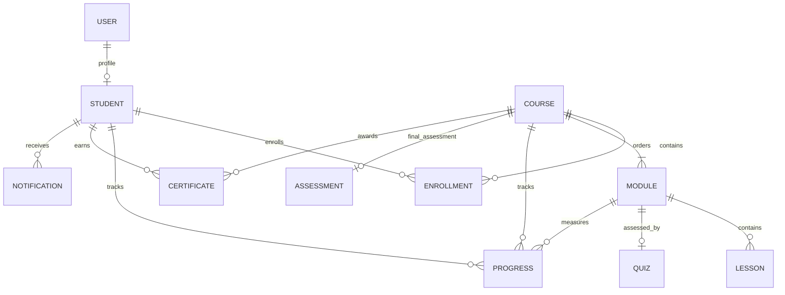

# LearnSpace collection relationships — Task 11

`Student.enrollments` references Enrollment documents, and `Course.modules` / `Module.lessons` reference ordered curriculum documents. `Module.quiz` and `Quiz.module` represent the one-to-one module quiz relationship. Quiz attempts are embedded in each student's per-module Progress record, so they do not form another collection. Reference synchronization and ownership validation are Task 12 service responsibilities.

Every course must contain at least 10 modules. This minimum is validated by the Course schema; the diagram's `COURSE ||--|{ MODULE` relationship also represents the required one-or-more association.
