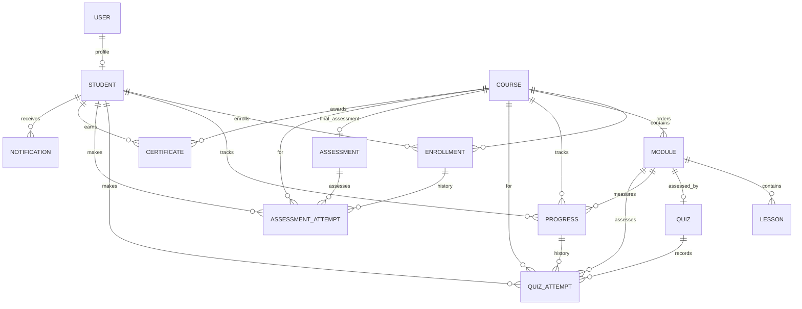

# LearnSpace collection relationships — Task 11

`Student.enrollments` references Enrollment documents, and `Course.modules` / `Module.lessons` reference ordered curriculum documents. `Module.quiz` and `Quiz.module` represent the one-to-one module quiz relationship. Progress retains only the current, maximum-two-attempt window; each accepted quiz submission is also stored as a separate `QuizAttempt` document. Unlimited final-assessment history is stored in separate `AssessmentAttempt` documents rather than embedded in Enrollment. Reference synchronization and ownership validation are Task 12 service responsibilities.

Every course must contain at least 10 modules. This minimum is validated by the Course schema; the diagram's `COURSE ||--|{ MODULE` relationship also represents the required one-or-more association.
